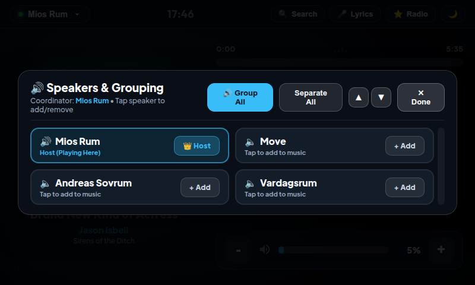

# Sonos Touchscreen Controller for Raspberry Pi (7" Touch Display)

A dedicated, standalone touch controller for your household **Sonos** sound system, specifically crafted for the **Raspberry Pi** and the **Official Raspberry Pi 7" Touchscreen (800×480)**.

Designed to live on your kitchen counter, living room wall, or bedside table as an instant, always-on smart home music hub.


---

## 📸 Interface & Feature Tour

| **Now Playing & Playback Controls** | **Multi-Room Grouping & Speakers** |
|:---:|:---:|
|  |  |
| *High-res artwork, tactile transport buttons & volume slider* | *1-tap grouping & separate for users in a hurry* |

| **Sonos Favorites & Radio** | **Power & System Menu (Bottom-Left)** |
|:---:|:---:|
|  |  |
| *1-tap access to TuneIn radio, playlists & stations* | *Hidden hot-corner for Desktop exit, reboot & safe shutdown* |

---

## 🌟 Key Features

- **Tailored 800×480 Touch Ergonomics**:
  - Pixel-exact UI layout designed specifically for the official 7" Raspberry Pi Touch Display.
  - Large capacitive touch targets (58px–76px) for effortless, tap-and-go control without needing a mouse or keyboard.
  - Zero scrollbars or cluttered desktop frames in full-screen Kiosk mode.
  - Chromium launched with `--password-store=basic` and `--use-mock-keychain` to eliminate OS keyring popups.

- **Streamlined Multi-Room Grouping (Built for Speed)**:
  - **All Speakers Always Visible**: Authoritative UPnP `ZoneGroupState` synchronization and disk caching guarantee 100% of household rooms are displayed immediately without omission or SSDP drops.
  - **1-Tap Room Toggle**: Tapping anywhere on a speaker card instantly toggles that speaker into (`[ ✓ Playing ]` in glowing emerald) or out of (`[ + Add ]` in neutral) the playback group with instant optimistic feedback.
  - **🔊 Group All**: 1-tap party mode instantly synchronizes music across all Sonos speakers in your home.
  - **Separate All**: 1-tap solo mode isolates playback back to the host coordinator only.
  - **1-Tap Scroll Buttons (`▲` and `▼`)**: Tactile header buttons to scroll speaker rows effortlessly for users in a hurry.
  - **Touch & Pointer Drag-to-Scroll**: Fluid drag scrolling with drag-threshold click suppression so dragging a finger never accidentally toggles a speaker.
  - **12px Touch Scrollbar**: Broad, high-contrast cyan scrollbar thumb easily operated by finger on 7" touchscreens.
  - **Compact 2-Column Grid (800×480)**: 54px compact card height fits 4 to 8 speakers comfortably without clipping.
  - **Playback Transport**: Big, tactile Play, Pause, Next Track, and Previous Track buttons.
  - **Touch Volume Control**: Capacitive touch volume slider with instant tactile step buttons (`-` and `+`) and 1-tap Mute.
  - **Scrubbing Seek Bar**: Tap anywhere on the progress track to jump forward or backward in the track.

- **🔍 Music Search & Touch Virtual Keyboard**:
  - Instant search across your local music library, NAS shares, and Sonos Favorites.
  - Search by artist, song/track title, or album.
  - Category filters: `All`, `🎤 Artists`, `🎵 Songs`, `💿 Albums`, and `⭐ Favorites`.
  - Built-in on-screen touch keyboard (QWERTY + numbers + Swedish Å, Ä, Ö keys) for typing directly on the 800×480 touchscreen without a physical keyboard.
  - Artist & album drilldown: browse an artist's full discography or an album's complete tracklist.
  - Play immediately (`▶ Play`), add to Sonos queue (`+ Queue`), or play all tracks (`▶ Play All`).

- **Now Playing Artwork & Visualizer**:
  - High-resolution album artwork with real-time dynamic ambient backlight glow.
  - Animated audio playback waveform.
  - Formatted elapsed / total duration countdowns.

- **Sonos Radio & Favorites (Touch-Swipe Carousel)**:
  - Slide-over drawer featuring an intuitive, multi-page horizontal swipable carousel (3×2 grid, 6 large cards per page) tailored for 800×480.
  - Swipe left or right with your finger, or tap the side `<` and `>` arrow buttons and interactive page indicator dots.
  - Category filter pills: `All`, `📻 Radio`, `🎵 Playlists`, and `⭐ Favorites`.
  - **1-Tap Save**: Tap `⭐ + Current` to immediately add the currently playing song, stream, or station to Sonos Favorites (`FV:2`).
  - **Custom Streams**: Tap `+ Station` to add custom radio stream URLs (MP3/AAC/TuneIn) or playlist names.
  - **Quick Favorite in Search**: Tap `⭐ Fav` on any track or album in search results to save it to your favorites instantly.
  - **Delete Favorites**: Remove favorites directly from the touch UI with a confirmation prompt.
  - Full UPnP browse integration retrieving all household favorites, radio stations, and saved queues without clipping or truncation.

- **🎤 Live Synchronized Lyrics Mode**:
  - One-tap drawer featuring synchronized word-by-word / line-by-line karaoke lyrics powered by LRCLIB.

- **🌙 Night / Sleep Mode**:
  - One-touch sleep mode transforms the screen into a subtle, low-light digital clock and date display.
  - Tap anywhere on the screen to wake it up instantly.

- **🔒 Hidden Power & Exit Menu (Bottom-Left Corner)**:
  - An unobtrusive, hidden touch button in the bottom-left corner opens a tactile system menu:
    - **Exit to Desktop**: Close kiosk mode and return to Raspberry Pi OS desktop.
    - **Restart Sonos App**: Cleanly reload the UI and backend service.
    - **Reboot Raspberry Pi**: Safely reboot the hardware.
    - **Shut Down Device**: Safely power off the Raspberry Pi.
    - **Check for Updates**: Pull latest commits from GitHub and restart the controller with 1 tap right from the screen.

- **100% Native ARM64 & ARMhf**:
  - Built with pure Python standard library and lightweight web standards.
  - Zero heavy x86 emulation or Wine overhead.
  - Uses < 35 MB of RAM on Raspberry Pi OS.

---

## 🛠️ Hardware Requirements

1. **Raspberry Pi** (Pi 3B or newer).
2. **Official Raspberry Pi 7" Touchscreen Display** (800×480 DSI) or any 7" HDMI/DSI capacitive display.
3. MicroSD card with **Raspberry Pi OS** (Bookworm or Bullseye with Desktop autologin enabled).
4. Standard 5V USB power supply.

---

## 🚀 Quick Installation

On your Raspberry Pi terminal (or via SSH):

```bash
# 1. Clone this repository
git clone https://github.com/handykpist/sonos-rpi-touchscreen.git
cd sonos-rpi-touchscreen

# 2. Run the automated installer
chmod +x install.sh
./install.sh
```

The installer will:
1. Verify system packages (`python3`, `chromium-browser`, `unclutter`).
2. Deploy the touchscreen application to `~/.local/share/sonos-touchscreen`.
3. Configure the systemd user service `sonos-touchscreen.service` to boot automatically into fullscreen Kiosk mode on startup.
4. Set up the `sonos-touchscreen-update.timer` to check for updates every night at 01:00 AM.

### 🔄 Updating an Existing Installation

If you already have `sonos-rpi-touchscreen` cloned and running on your Raspberry Pi:

```bash
cd ~/sonos-rpi-touchscreen
git pull
./install.sh
```
*(Running `./install.sh` refreshes all application files and ensures all systemd services and timers are active).*

---

## 📖 Touch Controls & Usage Guidelines

### 1. Speaker Grouping & Multi-Room Control
Tap the **Room Pill** button in the top-left corner (`Mios Rum ▼`). The **Speakers & Grouping** modal opens:
- **All Speakers Always Visible**: All household rooms are populated and updated dynamically via authoritative UPnP topology state and local disk cache.
- **1-Tap Card Toggle**: Tap anywhere on a speaker card to instantly toggle it into (**`[ ✓ Playing ]`** in glowing emerald) or out of (**`[ + Add ]`**) the active music group with immediate optimistic visual feedback.
- **🔊 Group All**: Tap the prominent blue action button to instantly link all speakers in your home to play in sync.
- **Separate All**: Tap to isolate playback so only the host speaker plays.
- **Host Coordinator**: The room actively playing and coordinating music is highlighted with a cyan border and `👑 Host` badge.
- **Effortless Scrolling (Built for Users in a Hurry)**:
  - **▲ / ▼ Scroll Buttons**: Tap the header arrow buttons to scroll speaker rows up or down instantly.
  - **Touch & Pointer Drag**: Drag your finger anywhere across the grid; smart drag-threshold click suppression ensures you never toggle a speaker by mistake while dragging.
  - **12px Tactile Scrollbar**: High-contrast, wide scrollbar thumb easily grabbed with a finger.
  - Tap **✕ Done** to close.

### 2. Music Search & Virtual Keyboard
Tap the **🔍 Search** button in the top-right header:
- **Instant Search**: Type an artist, song/track title, or album name. Search queries execute live.
- **On-Screen Keyboard**: A customized 4-row touch keyboard with numbers, QWERTY letters, and Swedish characters (**Å**, **Ä**, **Ö**) lets you search without a physical keyboard. Tap `⌨️ Keys` or `▼ Hide` to collapse it and expand results.
- **Filter Tabs**: Filter by `All`, `🎤 Artists`, `🎵 Songs`, `💿 Albums`, or `⭐ Favorites`.
- **Drilldown**: Tap any artist to view their full albums and track catalog. Tap an album to view its tracklist.
- **Playback Actions**:
  - Tap **▶ Play** on any track to start playback immediately.
  - Tap **+ Queue** to append the track to the current Sonos playback queue.
  - Tap **▶ Play All** inside an artist or album view to play the entire selection.

### 3. Playback & Scrubbing
- **Play / Pause**: Tap the large glowing circular center button.
- **Track Navigation**: Tap **⏮** for previous track or **⏭** for next track.
- **Seek Scrubbing**: Tap anywhere along the progress track bar to seek forward or backward.

### 4. Volume Control
- **Slider**: Drag your finger along the volume bar for fluid capacitive volume adjustment.
- **Step Buttons**: Tap `-` or `+` on either side of the slider for precise 2% incremental steps.
- **Mute**: Tap the speaker icon to toggle mute on or off.

### 5. Sonos Favorites & Radio (Swipable Carousel & Adding Favorites)
Tap the **⭐ Radio** button in the top-right header to open the Favorites drawer:
- **Touch-First Swiping**: Swipe left or right on the screen to smoothly browse through multiple pages of favorites and radio stations.
- **Carousel Controls**: Tap the side `<` and `>` arrows or tap any page dot in the bottom pagination bar to jump directly between pages.
- **Category Filter Tabs**: Tap `All`, `📻 Radio`, `🎵 Playlists`, or `⭐ Favorites` to filter your collection instantly.
- **1-Tap Play**: Tap any card to begin playing that station, playlist, or track immediately.
- **Save Current Song/Station**: Tap `⭐ + Current` in the drawer header to save whatever is currently playing to your Sonos Favorites.
- **Add Custom Station**: Tap `+ Station` to open the input modal, enter a station name and stream URL (MP3/AAC/TuneIn), and save it.
- **Favorite from Search**: When searching in the Music Search drawer, tap `⭐ Fav` next to any track or album to save it to Favorites.
- **Remove a Favorite**: Tap the small `✕` icon on any favorite card to delete it with a confirmation check.

### 6. Synchronized Lyrics
Tap the **🎤 Lyrics** button in the header. If timestamped lyrics exist for the current track, they will scroll in real time with the active singing line illuminated.

### 7. Night / Sleep Dimmer
Tap the **🌙** moon icon in the header. The screen enters a minimal, ultra-low power clock and date view. Tap anywhere on the display to wake it up.

### 8. Hidden Power & Exit Menu (Bottom-Left Corner)
To avoid accidental taps while keeping the UI clean, a subtle, hidden touch hot-corner is positioned at the **bottom-left corner** (`⏻`).
- Tap the bottom-left corner to open the **Power & System** menu.
- **Exit to Desktop**: Close Chromium kiosk mode and return to desktop.
- **Restart Sonos App**: Cleanly reload backend services and UI.
- **Reboot Raspberry Pi**: Safely restart the hardware.
- **Shut Down Device**: Safely power down the hardware.
- **Check for Updates**: Positioned right beneath the Shutdown button, tap to immediately fetch the latest code from GitHub, apply updates, and reload without needing SSH.

---

## 🔄 Screen Rotation (Upside-Down Display Fix)

Many popular 3D-printed cases and desktop stands for the official 7" display mount the screen upside down (so the power cables exit at the top or side).

Use the included rotation tool:

```bash
# Rotate 180 degrees (standard stand orientation)
sudo ~/.local/share/sonos-touchscreen/kiosk/setup_screen.sh rotate180
sudo reboot

# To reset to normal orientation:
sudo ~/.local/share/sonos-touchscreen/kiosk/setup_screen.sh rotate0
sudo reboot
```

### Manual Configuration:
- **Raspberry Pi OS Bookworm (Wayland / KMS)**: Add `video=DSI-1:800x480@60,rotate=180` to the end of the line in `/boot/firmware/cmdline.txt`.
- **Raspberry Pi OS Bullseye / Legacy (X11)**: Add `display_lcd_rotate=2` to `/boot/config.txt`.

---

## 💡 Backlight Brightness Control

You can adjust the screen brightness from terminal or scripts:

```bash
# Set brightness between 0 (off) and 255 (maximum)
sudo ~/.local/share/sonos-touchscreen/kiosk/setup_screen.sh brightness 180
```

---

## 🔧 Service Management & Shutdown

### Stop or Exit the Touchscreen App:
To close the fullscreen kiosk window and stop the controller from terminal:
```bash
~/.local/share/sonos-touchscreen/kiosk/exit_kiosk.sh
```
*(Or run `systemctl --user stop sonos-touchscreen && pkill -f "server.py"`)*

### Other Service Controls:
- **Start Controller**: `systemctl --user start sonos-touchscreen.service`
- **Restart Controller**: `systemctl --user restart sonos-touchscreen.service`
- **Check Status**: `systemctl --user status sonos-touchscreen.service`
- **View Live Kiosk Logs**: `journalctl --user -u sonos-touchscreen.service -f`
- **View Backend Server Logs**: `tail -f ~/.local/share/sonos-touchscreen/server.log`

### Safely Shut Down the Raspberry Pi Hardware:
To cleanly power off the Raspberry Pi without corrupting the SD card:
```bash
sudo shutdown -h now
```
*(or `sudo poweroff`)*

---

## 🌙 Nightly 01:00 Auto-Update

The controller includes an automated background updater that checks your Git repository every night at **01:00 AM** and applies updates without manual intervention.

- **Non-disruptive**: It checks remote Git commit hashes first. If no new commits were pushed, it exits silently and leaves your current playback uninterrupted.
- **Auto-Restart**: If a new commit is detected on GitHub, it fast-forward pulls the changes, syncs the application files, reloads systemd units, and restarts the kiosk smoothly.
- **Offline Resilient & Catch-Up**: Uses `Persistent=true` so if your Raspberry Pi was turned off at 01:00, it checks for updates immediately when powered on next.

### Auto-Update Commands:
- **Check Timer Schedule**:
  ```bash
  systemctl --user list-timers sonos-touchscreen-update.timer
  ```
- **Run Update Immediately (Manual Check)**:
  ```bash
  ~/.local/share/sonos-touchscreen/kiosk/auto_update.sh
  ```
- **Force Update**:
  ```bash
  ~/.local/share/sonos-touchscreen/kiosk/auto_update.sh --force
  ```
- **View Update History & Logs**:
  ```bash
  cat ~/.local/share/sonos-touchscreen/update.log
  ```

---

## 🌐 Remote Browser Access

You can also access the touch controller from any phone, tablet, or PC on your home Wi-Fi:

```
http://<raspberry-pi-ip>:5000
```

---

## 📄 License

MIT License. Designed with ❤️ for the Sonos and Raspberry Pi smart home community.
